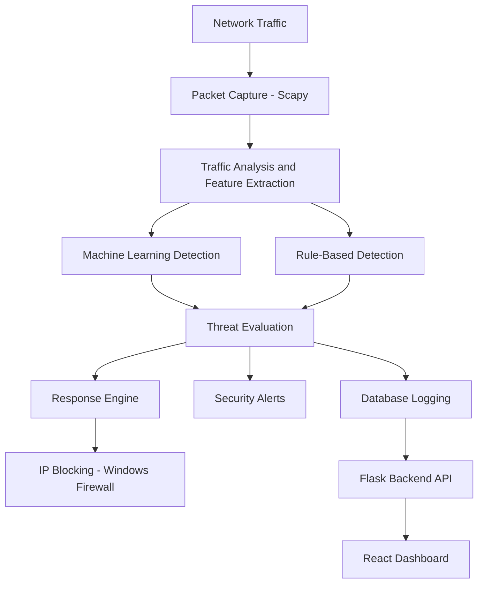

# Network Intrusion Detection and Prevention System (NIDS)

An AI-powered Network Intrusion Detection and Prevention System designed to monitor network traffic, identify suspicious activities, detect potential attacks, and support automated security responses through a centralized dashboard.

NIDS combines machine-learning-based detection with rule-based analysis to help administrators monitor network activity, investigate threats, and respond to suspicious behaviour.

**Repository:** https://github.com/mercterror/NIDS

## 1. Project Overview

Network security is an important requirement for modern organizations. Networks continuously exchange data, and suspicious activities can indicate threats such as unauthorized access attempts, port scanning, flooding attacks, and other malicious behaviour.

The Network Intrusion Detection and Prevention System (NIDS) was developed to provide a centralized platform for monitoring network activity and identifying potential security threats.

The system uses packet and traffic analysis, machine learning, rule-based detection, threat scoring, and response mechanisms. Its React-based dashboard provides administrators with visibility into traffic activity, detected attacks, connected devices, and security events.

## 2. Key Features

### Live Network Traffic Monitoring
- Captures and monitors network packets using Scapy.
- Extracts relevant network traffic information.
- Analyses protocols and network activity.
- Tracks network flows for monitoring and analysis.

### Machine Learning-Based Intrusion Detection
- Uses a Random Forest classification model.
- Extracts features from network traffic.
- Analyses traffic to identify potentially malicious behaviour.
- Supports real-time detection through the machine-learning detection pipeline.

### Rule-Based Threat Detection
- Uses predefined detection rules alongside machine-learning analysis.
- Evaluates suspicious network behaviour.
- Supports detection of patterns such as port scanning and flooding attacks.

### Threat Scoring and Response
- Evaluates detected suspicious activity.
- Uses a rule-based response engine to support security decisions.
- Supports automated IP-blocking actions through Windows Firewall.
- Includes a safe testing mode in which response actions can run in dry-run mode.

### Network Device Monitoring
- Provides device discovery functionality.
- Collects available device and network information.
- Displays connected-device information through the dashboard.

### Security Alerts and Notifications
- Supports email notifications.
- Supports Telegram notifications.
- Allows administrators to configure notification settings.

### Database Logging
- Uses SQLite for storing application data.
- Maintains traffic records and attack information.
- Stores device and dashboard-related information.

### Authentication and Access Control
- Provides authenticated dashboard access.
- Uses JSON Web Token (JWT) authentication.
- Includes administrator-level access checks for protected settings.

### Interactive Web Dashboard
- Built using React.js.
- Displays traffic information and security statistics.
- Provides views for attacks, devices, blocked entities, and notification settings.
- Uses charts and visual components to make network activity easier to understand.

## 3. System Architecture

The system follows a modular architecture in which network monitoring, traffic analysis, detection, response, database operations, and dashboard communication are handled by separate components.

### High-Level Workflow



### Architecture Components

**1. Packet Capture and Monitoring**

The packet-sniffing component captures network packets and extracts relevant information for further analysis.

**2. Feature Extraction and Traffic Analysis**

Network traffic information is processed into features required by the detection components.

**3. Machine Learning Detection**

The Random Forest model analyses extracted traffic features to classify potentially suspicious network activity.

**4. Rule-Based Detection**

The rule engine evaluates network behaviour using predefined detection conditions.

**5. Response Engine**

The response engine evaluates detection results and supports appropriate response actions, including IP blocking.

**6. Database and Alert System**

Traffic records and security events are stored in the database. Notification components support email and Telegram alerts.

**7. Backend API and Frontend**

The Flask backend provides application APIs, while the React frontend presents monitoring information through the administrator dashboard.

## 4. Technology Stack

| Component | Technologies |
|---|---|
| Backend | Python, Flask |
| Frontend | React.js, JavaScript |
| Build Tool | Vite |
| Packet Capture | Scapy |
| Machine Learning | Scikit-learn, Random Forest |
| Data Processing | Pandas, NumPy |
| Database | SQLite |
| Authentication | JWT |
| Network Response | Windows Firewall |
| Notifications | Email, Telegram Bot API |
| Visualization | Recharts |

## 5. Project Structure

```text
NIDS/
│
├── backend/
│   ├── alerts/
│   │   ├── email_alert.py
│   │   └── telegram_alert.py
│   │
│   ├── database/
│   │   └── database.py
│   │
│   ├── detection_engine/
│   ├── discovery/
│   ├── firewall/
│   ├── integration/
│   ├── ml/
│   ├── response_engine/
│   ├── rules/
│   ├── server/
│   │   └── app.py
│   ├── sniffer/
│   ├── traffic_simulator/
│   └── main.py
│
├── dataset/
│
├── frontend/
│   ├── public/
│   └── src/
│       ├── components/
│       ├── pages/
│       ├── services/
│       └── assets/
│
├── requirements.txt
└── README.md
```

## 6. Installation and Setup

### Prerequisites

- Python
- Node.js and npm
- Git
- Windows environment for the documented Windows Firewall response functionality
- Administrator privileges where required for packet capture and firewall operations

### Clone the Repository

```bash
git clone https://github.com/mercterror/NIDS.git
cd NIDS
```

### Backend Setup

Create and activate a Python virtual environment:

```bash
python -m venv .venv
```

On Windows:

```powershell
.venv\Scripts\activate
```

Install the Python dependencies:

```bash
pip install -r requirements.txt
```

Set the JWT secret key before starting the Flask API:

```powershell
$env:JWT_SECRET_KEY="replace-with-a-long-random-secret"
```

Start the backend API from the repository root:

```bash
python backend/server/app.py
```

The API is configured to run on port `5000`.

### Frontend Setup

Open another terminal and navigate to the frontend directory:

```bash
cd frontend
```

Install dependencies:

```bash
npm install
```

Start the development server:

```bash
npm run dev
```

Use the local URL displayed by Vite in the terminal to access the frontend.

**Setup note:** Check that `requirements.txt` contains all backend packages imported by the current source code before running the application. Configure any additional required environment variables and notification credentials locally. Never commit secrets or `.env` files.

## 7. Testing and Safe Operation

The project includes a safe testing approach for response actions. The response engine can operate in dry-run mode to avoid immediately applying firewall changes during testing.

Network packet capture and firewall operations may require elevated permissions. Test the system only on networks and devices for which you have authorization.

## 8. Screenshots

Add actual screenshots of the application here to help visitors understand the system.

Suggested screenshots:

- Administrator login page
- Main dashboard
- Live network traffic monitoring
- Intrusion detection and alerts
- Connected device monitoring
- Blocked IP information
- Notification settings

Example structure after adding screenshots:

```text
screenshots/
├── dashboard.png
├── traffic-monitoring.png
├── intrusion-alerts.png
├── device-monitoring.png
└── notification-settings.png
```

Then embed them in this section:

```markdown

```

## 9. Project Objectives

- Develop a centralized network monitoring platform.
- Identify suspicious network activities using machine learning.
- Combine machine-learning detection with rule-based analysis.
- Support threat evaluation and automated response mechanisms.
- Provide administrators with visibility into network traffic and security events.
- Maintain security-related records for monitoring and investigation.

## 10. Contributors

This project was developed collaboratively by:

- **Ahmed Naasif** — [GitHub: naasif2003](https://github.com/naasif2003)
- **mercterror** — [GitHub: mercterror](https://github.com/mercterror)

Both contributors participated in the development of the NIDS project. See the repository's Contributors graph for GitHub contribution history.

## 11. Disclaimer

This project is intended for educational, research, and authorized network-security testing purposes.

Network monitoring, packet capture, and firewall operations should only be performed on networks and systems for which appropriate authorization has been obtained.

The project should be tested in a controlled environment before being used in any production network.

---

**Project Repository:** https://github.com/mercterror/NIDS

**Developed collaboratively as a Network Intrusion Detection and Prevention System project.**
